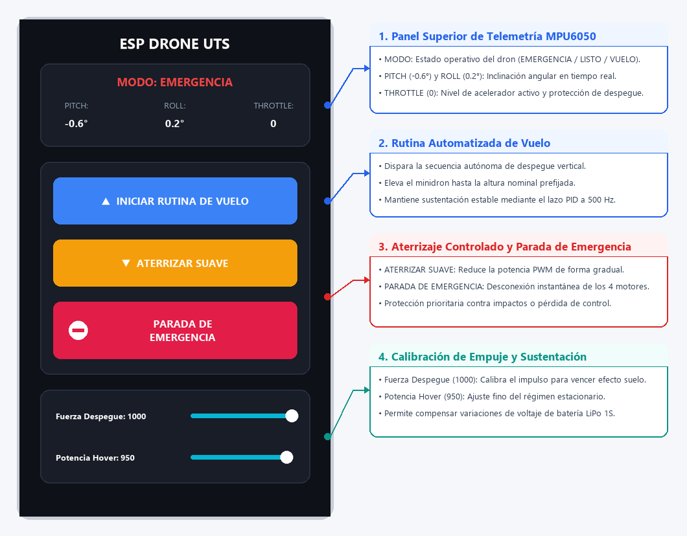
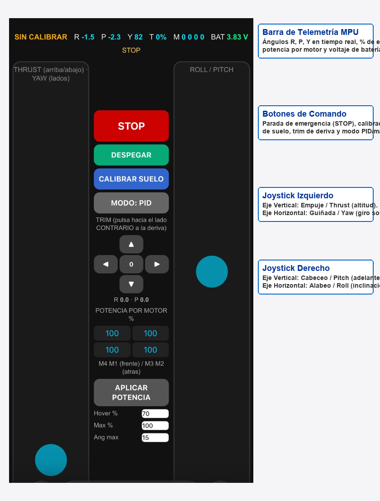

# ESP-DRONE UTS: Rutinas de Vuelo Automatizadas con ESP32-S2 y MPU6050

<p align="center">
  
</p>

Repositorio oficial del proyecto de grado para optar al título de **Tecnólogo en Gestión de Sistemas de Telecomunicaciones** en las **Unidades Tecnológicas de Santander (UTS)**.

---

## 👥 Autores y Dirección
* **Desarrolladores:** 
  * Jhon Erick Jesús Ramírez Ortega (C.C. 1098824785)
  * Ferney Jair Esparza Castro (C.C. 1095300127)
* **Directora:** Ing. Vivian Paola Triana Galeano
* **Codirector:** Ing. Johan Leandro Téllez Garzón
* **Grupo de Investigación:** GNET — Unidades Tecnológicas de Santander (UTS)

---

## 📌 Descripción del Proyecto
Este proyecto implementa y valida un sistema embebido de monocontrol para un minidrón cuadricóptero educativo basado en el chip **ESP32-S2-MINI-2** y la unidad inercial (IMU) **MPU6050**. Se diseñaron rutinas de vuelo autónomas secuenciales (despegue gradual, sustentación estacionaria/hover, traslación controlada y aterrizaje seguro con corte de motor) comandadas y monitoreadas de forma inalámbrica vía WiFi (protocolo UDP y servidor Web HTTP/WebSocket).

Adicionalmente, se desarrolló un panel de control interactivo responsive y una aplicación móvil especializada con transmisión de telemetría en tiempo real a 10 Hz y sistema de seguridad *Watchdog*.

---

## 🎥 Videos Demostrativos en Vuelo (YouTube Shorts)

Puedes observar el comportamiento dinámico y las pruebas experimentales del minidrón en los siguientes enlaces oficiales:

| Rutina | Descripción de la Maniobra | Video de Demostración |
| :--- | :--- | :---: |
| **Rutina 1** | Despegue vertical estabilizado, hover estacionario y aterrizaje suave con corte de seguridad | [Ver en YouTube](https://youtube.com/shorts/9VxdEOls3PE) |
| **Rutina 2** | Elevación, hover dinámico sostenido y compensación de actitud ante perturbaciones | [Ver en YouTube](https://youtube.com/shorts/wIUHFMTDS0Y) |
| **Rutina 3** | Trayectoria coordinada completa y control de descenso en área delimitada | [Ver en YouTube](https://youtube.com/shorts/wp47Jiy3K9M) |

---

## 📂 Estructura del Repositorio

```bash
esp-drone-uts/
├── assets/                 # Capturas, esquemas y recursos visuales
├── docs/                   # Documentación técnica adicional
├── firmware/               # Código fuente para ESP32-S2 (Arduino IDE / C++)
│   └── esp_drone_firmware.ino
├── manual/                 # Manual técnico-operativo de transferencia
│   └── Manual_Tecnico_MiniDron_ESP32.pdf
└── web_interface/          # Panel de control web responsive y telemetría
    └── control_drone.html
```

---

## 🛠️ Características del Firmware Embebido (`esp_drone_firmware.ino`)
* **Monocontrol Embebido:** Lazo cerrado de estabilización de actitud y gestión de telecomunicaciones centralizados en el núcleo Xtensa LX7 a 240 MHz.
* **Filtro Complementario / Estimación Angular:** Fusión sensorial inercial con compensación de deriva angular a periodo de muestreo determinista ($T = 4\,\text{ms}$, 250 Hz).
* **Control PID en Cascada:** Lazos independientes para Ángulo (*Outer Loop*) y Velocidad Angular (*Rate Loop*) en Pitch, Roll y Yaw.
* **Máquina de Estados de Vuelo:**
  * `IDLE` / `ARMED_IDLE`: Verificación de sensores y armado seguro.
  * `ROUTINE_TAKEOFF`: Aceleración gradual con rampa matemática sin salto abrupto.
  * `ROUTINE_HOVER`: Sustentación estabilizada en altura de trabajo.
  * `ROUTINE_LANDING`: Rampa descendente de modulación PWM y corte por umbral de inclinación (*Tilt Cut* a 22° / 50°).
* **Seguridad Activa:** Watchdog de señal UDP (corte tras 500 ms de pérdida de paquete y apagado forzado a los 2000 ms).

---

## 📱 Panel de Control Web y Aplicación Móvil
El sistema proporciona un servidor web embebido alojado en la IP fija `192.168.43.42` (o `192.168.4.1` según el modo SoftAP):
1. **Telemetría en Vivo:** Monitoreo angular de inclinación (Roll, Pitch, Yaw), nivel de batería y paquetes UDP recibidos.
2. **Trim Digital:** Ajuste fino de compensación para cada uno de los 4 motores coreless.
3. **Parada de Emergencia Inmediata:** Desconexión forzada de los transistores MOSFET ante cualquier anomalía.

<p align="center">
  
</p>

---

## 📖 Manual Técnico-Operativo
Para la réplica del hardware, calibración de sensores y procedimientos paso a paso de puesta en marcha, consulte el manual completo en:
👉 [`manual/Manual_Tecnico_MiniDron_ESP32.pdf`](manual/Manual_Tecnico_MiniDron_ESP32.pdf)

---

## 📄 Licencia
Este desarrollo tiene fines educativos y de investigación, desarrollado en el marco del grupo **GNET** de las **Unidades Tecnológicas de Santander**.

