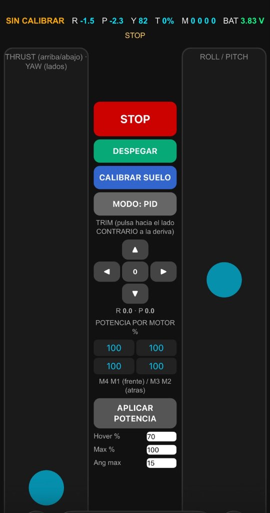
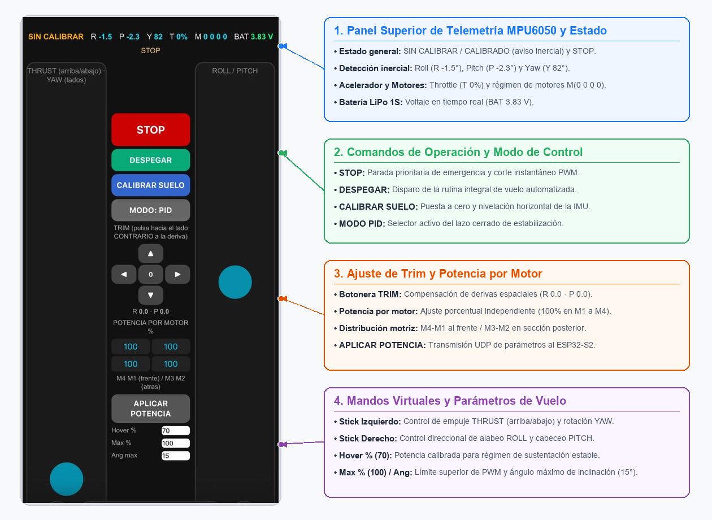
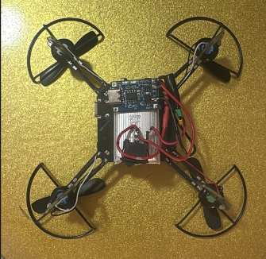
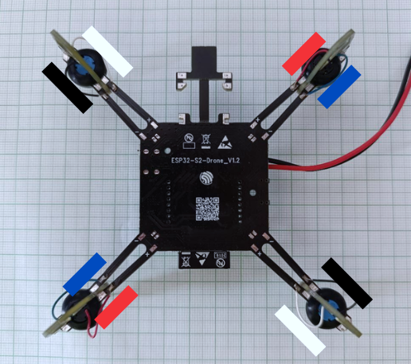
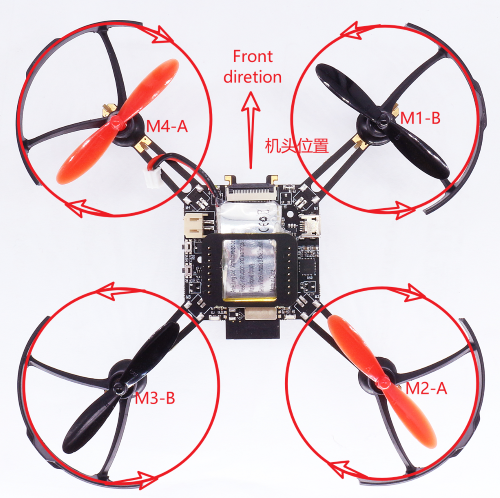

# ESP-DRONE UTS: Rutinas de Vuelo Automatizadas con ESP32-S2 y MPU6050

<p align="center">
  
</p>

Repositorio oficial del proyecto de grado para optar al título de **Tecnólogo en Gestión de Sistemas de Telecomunicaciones** en las **Unidades Tecnológicas de Santander (UTS)**.

---

## 👥 Autores y Dirección
* **Desarrolladores:** 
  * Jhon Erick Jesús Ramírez Ortega (C.C. 1098824785)
  * Ferney Jair Esparza Castro (C.C. 1095300127)
* **Directora:** Ing. Vivian Paola Triana Galeano
* **Codirector:** Ing. Johan Leandro Téllez Garzón
* **Grupo de Investigación:** GNET — Unidades Tecnológicas de Santander (UTS)

---

## 📌 Descripción del Proyecto
Este proyecto implementa y valida un sistema embebido de monocontrol para un minidrón cuadricóptero educativo basado en el chip **ESP32-S2-MINI-2** y la unidad inercial (IMU) **MPU6050**. Se diseñaron rutinas de vuelo autónomas secuenciales (despegue gradual, sustentación estacionaria/hover, traslación coordinada y aterrizaje suave con corte automático) comandadas y monitoreadas de forma inalámbrica vía WiFi.

El minidrón cuenta con un sistema de control dual:
1. **Aplicación Móvil dedicada ("ESP DRONE UTS")**: instalable mediante archivo APK en Android y mediante Progressive Web App (PWA) en iOS/iPhone para telemetría en tiempo real y disparo de rutinas de vuelo.
2. **Acceso Web Universal Directo**: el ESP32-S2 aloja un servidor web HTTP en su memoria; al conectarse a la red WiFi del dron, cualquier dispositivo (móvil, tablet o PC) puede abrir su navegador e ingresar a la dirección IP **`http://192.168.43.42`** para acceder al panel HTML de control completo, telemetría y parada de emergencia sin instalar ninguna aplicación adicional.

---

## 🎥 Videos Demostrativos en Vuelo (YouTube Shorts)

| Rutina | Maniobra de Vuelo | Video Demostrativo |
| :--- | :--- | :---: |
| **Rutina 1** | Despegue vertical con rampa de empuje, hover estacionario estabilizado y descenso suave con corte de seguridad | [Ver en YouTube](https://youtube.com/shorts/9VxdEOls3PE) |
| **Rutina 2** | Elevación progresiva, sustentación prolongada y compensación activa de actitud ante perturbaciones | [Ver en YouTube](https://youtube.com/shorts/wIUHFMTDS0Y) |
| **Rutina 3** | Trayectoria coordinada completa y control de descenso en área delimitada | [Ver en YouTube](https://youtube.com/shorts/wp47Jiy3K9M) |

---

## 📱 Aplicación Móvil: Descarga e Instalación (Android e iPhone)

El repositorio incluye la versión compilada oficial de la aplicación móvil en la carpeta [`mobile_app/`](mobile_app/):
* ⬇️ **[Descargar APK Directamente en tu Celular (Clic Aquí)](https://github.com/ferney-lab/Esp-Dron-UTS/raw/main/mobile_app/ESP_DRONE_UTS_v1.0.apk)** *(6.99 MB — Descarga directa sin pantalla de error)*
* 📂 Ubicación en el repositorio: [`mobile_app/ESP_DRONE_UTS_v1.0.apk`](mobile_app/ESP_DRONE_UTS_v1.0.apk)

> ℹ️ **¿Por qué sale el mensaje *"Disculpen las molestias, pero en este momento no podemos mostrar archivos de este tamaño"* en GitHub?**  
> GitHub es una plataforma de código y sólo puede previsualizar en pantalla archivos de texto o imágenes de menos de 1 MB. Al abrir un archivo binario compilado como un `.apk` (7 MB), GitHub informa que no puede mostrarlo en pantalla. **Esto es completamente normal:** para descargarlo solo debes hacer clic en el botón **`Download`** (o **`Descargar`**) que aparece en la parte superior derecha de esa pantalla, o bien utilizar el enlace de **[Descarga Directa](https://github.com/ferney-lab/Esp-Dron-UTS/raw/main/mobile_app/ESP_DRONE_UTS_v1.0.apk)**.

```
                       ┌───────────────────────────────────────────────┐
                       │          ¿Cómo instalar la aplicación?        │
                       └──────┬─────────────────────────────────┬──────┘
                              │                                 │
                     ┌────────▼─────────┐             ┌─────────▼────────┐
                     │ Dispositivo      │             │ Dispositivo      │
                     │ ANDROID          │             │ APPLE iPhone     │
                     └────────┬─────────┘             └─────────┬────────┘
                              │                                 │
                     1. Descargar APK                 1. Conectar a WiFi
                     2. Habilitar fuentes                ESP-DRONE_XXXX
                        desconocidas                  2. Abrir Safari en
                     3. Instalar y abrir                 192.168.43.42
                                                      3. Compartir ➔
                                                         "Agregar a inicio"
```

### 🤖 1. Instalación en Celulares Android (Archivo .APK)
1. **Descarga:** Descargue el archivo **`ESP_DRONE_UTS_v1.0.apk`** en su teléfono Android.
2. **Permisos de instalación:** Al pulsar sobre el APK descargado, si el sistema lo solicita, active la opción *"Permitir instalación desde esta fuente"* (o *"Fuentes desconocidas"* en Ajustes ➔ Seguridad).
3. **Instalación:** Presione **Instalar** y espere unos segundos hasta la confirmación de instalación finalizada.
4. **Conexión:** Conéctese a la red Wi-Fi del dron (`ESP-DRONE_XXXX`, clave `12345678`), abra la app y disfrute del control en vivo.

### 🍏 2. Instalación en Celulares iPhone / iOS (Modo PWA - Safari)

> ⚠️ **¿Por qué un archivo .apk no abre en iPhone?**  
> Los archivos con extensión `.apk` (*Android Package Kit*) están compilados exclusivamente para el sistema operativo Android de Google. Apple iOS es un entorno cerrado que **no permite ejecutar archivos .apk**, mostrando una pantalla en negro de datos genéricos.

**Solución Oficial y Nativa para iPhone (Progressive Web App):**  
El firmware del minidrón integra una **PWA nativa** en el ESP32-S2 que permite a los usuarios de iPhone instalar la aplicación directamente en la pantalla de inicio con la misma fluidez y respuesta de una app de la App Store:

1. **Conectar el iPhone al Wi-Fi del dron:**
   * Vaya a **Ajustes ➔ Wi-Fi** y elija la red:  
     * **SSID:** `ESP-DRONE_XXXX`  
     * **Contraseña:** `12345678`  
   * *(Si iOS advierte "Sin conexión a internet", seleccione "Mantener conexión Wi-Fi")*.
2. **Abrir en Safari:**
   * Abra el navegador **Safari** en su iPhone e ingrese a la dirección:  
     👉 **`http://192.168.43.42`**
3. **Agregar a la Pantalla de Inicio:**
   * En la parte inferior de Safari, toque el botón **Compartir** (ícono del cuadrado con flecha hacia arriba 📤).
   * Deslice hacia abajo y toque en **"Agregar a pantalla de inicio"** (*Add to Home Screen*).
   * Confirme el nombre sugerido (**ESP-DRONE UTS**) y presione **"Agregar"** en la esquina superior derecha.
4. **Listo:** En la pantalla de su iPhone se creará el ícono de la app. Al tocarlo se abrirá en **pantalla completa** (sin barras ni menús de Safari), con caché local y controles táctiles de respuesta inmediata.

---

## 🎮 Guía de Uso de la Aplicación y Funciones de Cada Botón

<p align="center">
  
</p>

### 1. Botones Principales de Control
* 🛑 **STOP (Parada de Emergencia):**  
  Corta inmediatamente el 100 % de la potencia (PWM = 0) a los cuatro motores. Prioridad absoluta ante choques o desvíos.
* 🛫 **DESPEGAR (Despegue Progresivo Asistido):**  
  Aplica una rampa suave en curva S durante 3 segundos hasta alcanzar la potencia de sustentación (*Hover* al 70 %) y mantiene la estabilidad en vuelo.
* 🛬 **ATERRIZAR:**  
  Inicia una rampa de descenso suave y progresiva; al detectar el contacto con el suelo (>20 ms de desaceleración sostenida), apaga los motores automáticamente.
* 1️⃣ **1 VERTICAL:** Dispara la secuencia de vuelo vertical autónomo (subir, flotar y aterrizar).
* 2️⃣ **2 DERECHA:** Dispara la secuencia de traslación horizontal a la derecha y retorno seguro a tierra.
* 3️⃣ **3 VUELTA IZQUIERDA:** Dispara la maniobra de rotación completa de 360° en el eje de guiñada (*Yaw*) y aterrizaje.

### 2. Controles de Vuelo Manual (Joysticks Virtuales)
* **Joystick Izquierdo (Acelerador y Guiñada):**
  * **Eje Vertical (Thrust):** Control de empuje global (0 % a 100 %).
  * **Eje Horizontal (Yaw):** Rotación del dron sobre su propio eje vertical (giro horario/antihorario).
* **Joystick Derecho (Alabeo y Cabeceo):**
  * **Eje Vertical (Pitch):** Inclinación hacia adelante o atrás para avanzar o retroceder.
  * **Eje Horizontal (Roll):** Inclinación lateral izquierda o derecha para traslación de lado.

### 3. Barra de Telemetría en Tiempo Real
* **R (Roll):** Ángulo de inclinación lateral en grados (°).
* **P (Pitch):** Ángulo de inclinación longitudinal en grados (°).
* **Y (Yaw):** Orientación angular actual en grados (°).
* **T (Thrust):** Porcentaje de aceleración global suministrado a los motores.
* **M1, M2, M3, M4:** Potencia individual enviada a cada motor por el mezclador de vuelo.
* **BAT:** Voltaje medido en vivo de la batería LiPo (ejemplo: `3.84 V`).
* **Estado:** Indicador de fase actual (`LISTO`, `CALIBRANDO`, `DESPEGANDO`, `EN EL AIRE`, `ATERRIZANDO`).

---

## ❓ ¿Qué pasa si se presionan la Rutina 1 y la Rutina 2 al mismo tiempo?

> **Respuesta Técnica:** **No ocurre ningún fallo ni conflicto.** El dron **únicamente recibe y atiende una sola orden a la vez**.

**Explicación del comportamiento interno:**
1. **Atomoicidad del Servidor:** El microcontrolador ESP32-S2 atiende las peticiones entrantes de forma estrictamente secuencial a través del despachador `server.handleClient()`.
2. **Máquina de Estados Finita (`runSeq()`):** El secuenciador de rutinas opera bajo estados bien definidos: `SEQ_IDLE`, `SEQ_CALIB`, `SEQ_CLIMB`, `SEQ_HOVER`, `SEQ_MOVE` y `SEQ_LAND`.
3. **Bloqueo de Nuevas Órdenes Durante el Vuelo:** Para que el dron acepte el inicio de una rutina, la máquina de estados exige que el estado sea estrictamente **`SEQ_IDLE`** (en tierra y en reposo). En el instante en que se presiona la Rutina 1, el estado cambia a `SEQ_CALIB`. Si en ese mismo instante o instantes después se presiona el botón de la Rutina 2 (o viceversa), el firmware **descarta y rechaza automáticamente la segunda orden**, manteniéndose enfocado al 100 % en la primera rutina iniciada.
4. Una vez la rutina en ejecución finaliza, aterriza suavemente y apaga los motores, el sistema regresa al estado **`LISTO`** (`SEQ_IDLE`), quedando disponible para aceptar una nueva instrucción.  
*(Nota: El único botón con prioridad de interrupción en cualquier instante es **`STOP`**, que apaga los motores de inmediato por seguridad).*

---

## 🚀 Explicación y Resultados Detallados de Cada Rutina

Cada rutina ha sido programada y verificada matemáticamente y en pruebas de campo:

### 1️⃣ Rutina 1: Vuelo Vertical Asistido (Hover y Aterrizaje)
* **Punto de Partida:** Dron ubicado en el suelo en posición completamente horizontal.
* **Fase 1 (Recalibración de Giroscopio - 1.0 s):** Motores apagados. El sensor MPU6050 actualiza su sesgo de cero para garantizar máxima precisión.
* **Fase 2 (Despegue Progresivo):** Rampa suave de aceleración hasta que el acelerómetro detecta que el dron se despega del suelo.
* **Fase 3 (Ascenso Controlado - 1.2 s):** Sube hasta alcanzar una altura aproximada de **35 a 40 cm**.
* **Fase 4 (Hover Estacionario - 5.0 s):** Se mantiene flotando en el aire a altura constante; el controlador PID compensa perturbaciones de viento o desbalances de peso manteniendo el chasis plano ($0^\circ$).
* **Fase 5 (Descenso y Aterrizaje):** Reduce el empuje de forma progresiva a 0.5 %/s hasta posarse suavemente en el suelo.
* **Fase 6 (Finalización):** Al detectar contacto con el suelo (>20 ms), apaga todos los motores y vuelve al estado `LISTO` a la espera de una nueva orden.
* ⏱️ **Duración total:** ~10 a 11 segundos.

---

### 2️⃣ Rutina 2: Traslación Lateral a la Derecha
* **Punto de Partida:** Dron en el suelo.
* **Fase 1 (Despegue y Elevación - 1.2 s):** Calibración y ascenso vertical hasta la altura de crucero (~35 a 40 cm).
* **Fase 2 (Estabilización - 0.3 s):** Nivela el dron en el aire.
* **Fase 3 (Desplazamiento Lateral - 1.2 s):** El controlador inclina el dron con un ángulo de **Roll = +8° hacia la derecha**, generando un desplazamiento lateral controlado de **50 a 60 cm**.
* **Fase 4 (Frenado Dinámico Activo - 1.2 s):** Aplica una inclinación contraria hacia la izquierda para anular la inercia acumulada y detener el avance.
* **Fase 5 (Estabilización Final - 1.5 s):** Recupera la actitud horizontal ($0^\circ$) en punto fijo.
* **Fase 6 (Descenso y Apagado):** Aterriza de forma suave, corta la potencia a los 4 motores y regresa a estado `LISTO`.
* ⏱️ **Duración total:** ~12 a 13 segundos.

---

### 3️⃣ Rutina 3: Vuelta Completa a la Izquierda (Giro Yaw 360°)
* **Punto de Partida:** Dron en el suelo.
* **Fase 1 (Despegue y Elevación):** Ascenso suave hasta 35 a 40 cm de altura.
* **Fase 2 (Estabilización - 0.3 s):** Retención de altura horizontal.
* **Fase 3 (Rotación 360° en Yaw - ~4.0 s):** Comanda una velocidad angular de **90°/segundo en sentido antihorario** (hacia la izquierda visto desde arriba). Los motores diagonales modulan su torque reactivo completando una rotación exacta de 360° sobre su propio centro de gravedad.
* **Fase 4 (Amortiguamiento Angular - 1.5 s):** El PID de guiñada frena la rotación y estabiliza la orientación del dron.
* **Fase 5 (Aterrizaje y Apagado):** Descenso progresivo, contacto en tierra, corte de motores y retorno al estado `LISTO` a la espera de la siguiente orden.
* ⏱️ **Duración total:** ~14 segundos.

---

## 🔨 Construcción y Ensamble del Dron (Capítulo 4 del Informe)

<p align="center">
  
</p>

### 1. Arquitectura de Chasis y Disposición en "X"
El dron utiliza una estructura de cuadricóptero con disposición en **"X"**, lo que proporciona un balance simétrico de empuje entre los ejes de alabeo (Roll) y cabeceo (Pitch). 

### 2. Soldadura y Polarización de los Motores
La correcta conexión de los cuatro motores coreless a la tarjeta PCB principal es fundamental para el vuelo:
* **M1 (Delantero Derecho):** Giro Antihorario (CCW) — Cables negro y blanco.
* **M2 (Trasero Derecho):** Giro Horario (CW) — Cables azul y rojo.
* **M3 (Trasero Izquierdo):** Giro Antihorario (CCW) — Cables negro y blanco.
* **M4 (Delantero Izquierdo):** Giro Horario (CW) — Cables azul y rojo.

<p align="center">
  
</p>

### 3. Orientación y Dirección de Giro de las Hélices
Para contrarrestar el torque de arrastre (*Drag Torque*) y evitar la rotación descontrolada sobre el eje de guiñada (Yaw), se colocan dos hélices con paso horario (CW) y dos con paso antihorario (CCW):

<p align="center">
  
</p>

---

## 🛠️ Arquitectura del Firmware Embebido (`esp_drone_firmware.ino`)

El firmware del proyecto incorpora las siguientes innovaciones técnicas en su versión más reciente:
* **Monocontrol en Tiempo Real:** Procesamiento concurrente en ESP32-S2 (240 MHz) bajo FreeRTOS con tarea de estabilización a **500 Hz** ($T = 2\,\text{ms}$) y muestreo de sensores I2C a **1 kHz**.
* **Fusión Sensorial:** Filtro de Mahony a 250 Hz combinando giroscopio (±2000 dps) y acelerómetro (±16 g) con eliminación de sesgo por varianza estática.
* **Corrección de Yaw y Mezclador Dinámico:** Prioridad estricta para Roll y Pitch; apertura dinámica de margen para Yaw ajustando thrust con protección anti-windup en los integrales.
* **Potencia de Motores al 104 %:** Margen de conmutación para exprimir el rendimiento de los motores 720 coreless a 15 kHz de PWM.
* **Despegue Progresivo en Curva S:** Aceleración suave durante 3 s evitando oscilaciones abruptas causadas por desniveles del suelo.
* **Detección Automática de Contacto:** Desconexión inmediata de motores al tocar tierra para evitar sobrecalentamientos.

---

## 📖 Manual Técnico Completo

Para conocer a fondo el circuito esquemático, cálculos matemáticos del PID, diagramas de conexión de pines, comandos de consola serie (115200 baudios) y resolución de problemas, consulte:
* 📘 **[Manual Técnico Completo en Markdown](manual/MANUAL_TECNICO.md)**
* 📑 [Manual de Transferencia en PDF](manual/Manual_Tecnico_MiniDron_ESP32.pdf)
* 📝 [Manual de Transferencia en Word](manual/Manual_Tecnico_MiniDron_ESP32.docx)

---

## 📂 Estructura del Repositorio

```bash
esp-drone-uts/
├── assets/                 # Imágenes, capturas de app, fotos de ensamble y esquemas
├── firmware/               # Firmware para ESP32-S2 (Arduino IDE / C++)
│   └── esp_drone_firmware.ino
├── manual/                 # Manuales técnicos y guías de operación
│   ├── MANUAL_TECNICO.md   # Manual técnico integral paso a paso
│   ├── Manual_Tecnico_MiniDron_ESP32.pdf
│   ├── Manual_Tecnico_MiniDron_ESP32.docx
│   └── README.md
└── mobile_app/             # Aplicación móvil oficial
    ├── ESP_DRONE_UTS_v1.0.apk  # APK instalable para Android
    └── README.md           # Guía de instalación para Android e iPhone
```

---

## 📄 Licencia y Créditos
Proyecto desarrollado con fines investigativos y pedagógicos en el marco del grupo de investigación **GNET** de las **Unidades Tecnológicas de Santander (UTS)**, Bucaramanga, Colombia.
