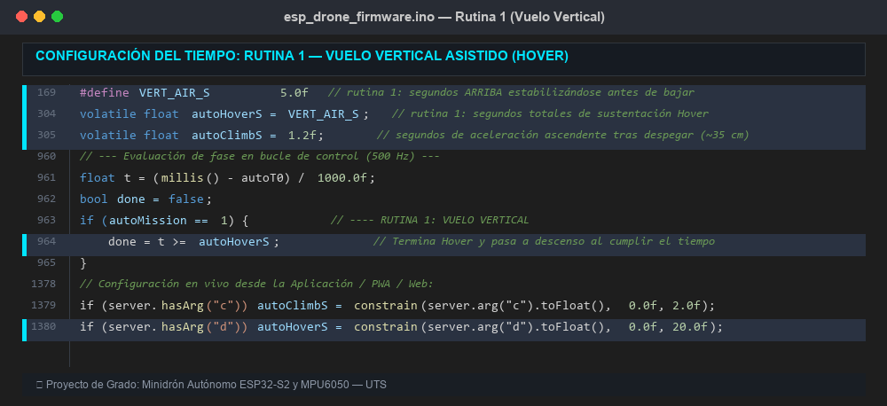
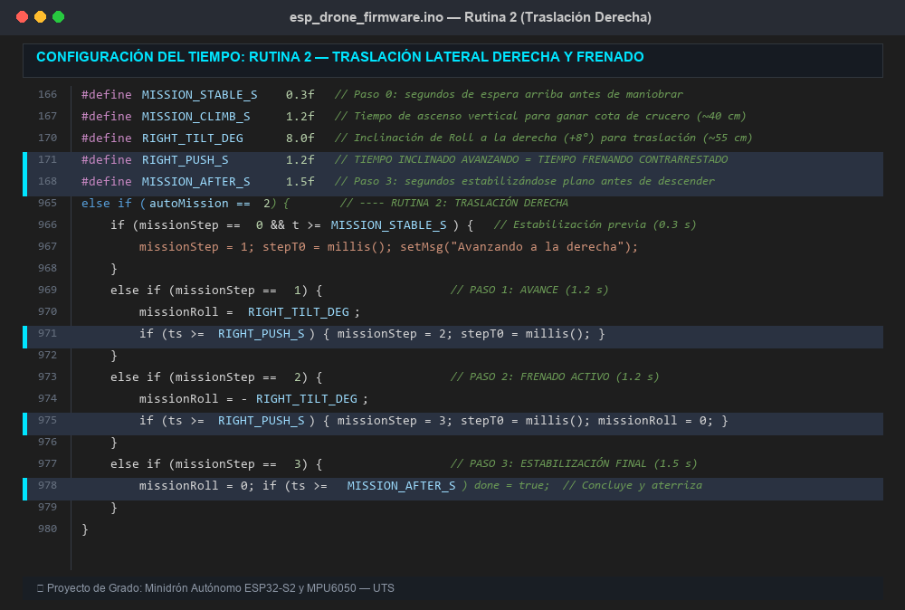
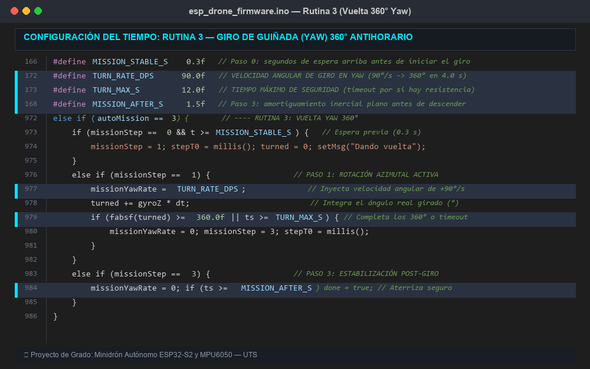

# Configuración de los Parámetros Temporales de las Rutinas de Vuelo

## Introducción

El firmware `ESP_DRONE_ARDUINO` permite la configuración de los parámetros temporales que gobiernan la duración de cada fase en las tres rutinas de vuelo autónomo. Estos parámetros se definen como constantes preprocesador (`#define`) en el archivo fuente [`firmware/esp_drone_firmware.ino`](../firmware/esp_drone_firmware.ino) y pueden modificarse de dos formas:

1. **Estática (recompilando):** Modificar el valor del `#define` en el código fuente y volver a cargar el firmware al ESP32 desde Arduino IDE.
2. **Dinámica (en tiempo real):** Desde la app móvil ESP DRONE UTS, el campo "Arriba s" envía un comando HTTP que actualiza la variable en la RAM del ESP32 sin recompilar.

---

## Tabla de Constantes de Tiempo

| Constante | Valor por defecto | Rutina(s) | Descripción |
|-----------|:-----------------:|:---------:|-------------|
| `VERT_AIR_S` | 5.0 s | R1 | Tiempo de sustentación estacionaria (hover) |
| `MISSION_STABLE_S` | 0.3 s | R2, R3 | Espera de estabilización antes de la maniobra |
| `MISSION_CLIMB_S` | 1.2 s | R2, R3 | Tiempo mínimo de subida para misiones |
| `MISSION_AFTER_S` | 1.5 s | R2, R3 | Estabilización posterior a la maniobra |
| `RIGHT_TILT_DEG` | 8.0° | R2 | Ángulo de inclinación lateral (roll) |
| `RIGHT_PUSH_S` | 1.2 s | R2 | Duración del empuje lateral y del frenado |
| `TURN_RATE_DPS` | 90.0 °/s | R3 | Velocidad angular del giro (yaw) |
| `TURN_MAX_S` | 12.0 s | R3 | Timeout de seguridad del giro |

Variables en RAM (ajustables desde la app):

| Variable | Valor inicial | Descripción |
|----------|:------------:|-------------|
| `autoHoverS` | `VERT_AIR_S` (5.0) | Tiempo de hover activo, modificable vía HTTP |
| `autoClimbS` | 1.2 | Duración de la rampa de ascenso |

---

## Rutina 1: Vuelo Vertical, Sustentación Temporizada y Aterrizaje

### Ubicación en el código fuente



### Código relevante

```cpp
// Línea 169 — Constante por defecto de sustentación (hover)
#define VERT_AIR_S 5.0f

// Líneas 304-305 — Variables en memoria
volatile float autoHoverS = VERT_AIR_S;  // 5.0 s por defecto
volatile float autoClimbS = 1.2f;        // Tiempo de rampa de subida

// Líneas 963-964 — Condición de finalización en autoStep()
if (autoMission == 1) {
  done = t >= autoHoverS;   // Termina cuando el tiempo en hover alcanza autoHoverS
}
```

### Cómo cambiar el tiempo

**Opción 1 – En el código (permanente):**
```cpp
// Cambiar de 5 a 8 segundos de hover:
#define VERT_AIR_S 8.0f

// Cambiar la rampa de subida (altura de vuelo):
volatile float autoClimbS = 1.8f;  // Más alto (~50 cm)
```

**Opción 2 – Desde la App (dinámico, sin recompilar):**
El campo "Arriba s" en la app envía:
```
GET /auto?m=1&c=1.2&d=8.0
```
Donde `d` actualiza `autoHoverS` y `c` actualiza `autoClimbS` directamente en la RAM del ESP32.

---

## Rutina 2: Traslación Lateral Derecha con Frenado Activo

### Ubicación en el código fuente



### Código relevante

```cpp
// Líneas 166-170 — Constantes de maniobra
#define MISSION_STABLE_S 0.3f   // Paso 0: Estabilización inicial
#define RIGHT_TILT_DEG   8.0f   // Ángulo de inclinación (roll)
#define RIGHT_PUSH_S     1.2f   // Paso 1 y 2: Duración de empuje y freno
#define MISSION_AFTER_S  1.5f   // Paso 3: Estabilización final

// Líneas 965-969 — Máquina de estados en autoStep()
} else if (autoMission == 2) {
  if (missionStep == 0 && t >= MISSION_STABLE_S)
    { missionStep = 1; missionT0 = t; }
  else if (missionStep == 1) {
    missionRoll = RIGHT_TILT_DEG;          // +8° → empuja a la derecha
    if (t - missionT0 >= RIGHT_PUSH_S)
      { missionStep = 2; missionT0 = t; }
  }
  else if (missionStep == 2) {
    missionRoll = -RIGHT_TILT_DEG;         // −8° → frena (contra-impulso)
    if (t - missionT0 >= RIGHT_PUSH_S)
      { missionStep = 3; missionT0 = t; }
  }
  else if (missionStep == 3) {
    missionRoll = 0.0f;                    // Nivel → estabilización final
    done = (t - missionT0 >= MISSION_AFTER_S);
  }
}
```

### Duración total de la maniobra

```
Tiempo total = MISSION_STABLE_S + RIGHT_PUSH_S + RIGHT_PUSH_S + MISSION_AFTER_S
             = 0.3 + 1.2 + 1.2 + 1.5
             = 4.2 segundos (sin contar subida ni aterrizaje)
```

### Cómo cambiar el tiempo

| Para... | Modificar | Ejemplo |
|---------|-----------|---------|
| Mayor distancia lateral | `RIGHT_PUSH_S` | `2.0f` → empuja 2 s + frena 2 s |
| Menor distancia | `RIGHT_PUSH_S` | `0.8f` → empuja 0.8 s + frena 0.8 s |
| Mayor velocidad de traslación | `RIGHT_TILT_DEG` | `12.0f` → 12° de inclinación |
| Más tiempo de estabilización al final | `MISSION_AFTER_S` | `2.5f` → 2.5 s quieto antes de bajar |

---

## Rutina 3: Giro Yaw 360° Antihorario

### Ubicación en el código fuente



### Código relevante

```cpp
// Líneas 171-172 — Constantes de giro
#define TURN_RATE_DPS  90.0f   // Velocidad angular: 90°/s → 360°/90 = 4.0 s
#define TURN_MAX_S     12.0f   // Timeout de seguridad

// Líneas 972-983 — Control por integración angular
} else if (autoMission == 3) {
  if (missionStep == 0 && t >= MISSION_STABLE_S) {
    missionStep = 1; missionT0 = t; missionYawAcc = 0.0f;
  } else if (missionStep == 1) {
    missionYawRate = TURN_RATE_DPS;             // Comando de giro
    missionYawAcc += fabsf(gz) * dt;            // Integra ángulo real girado
    float turnDur = t - missionT0;
    if (missionYawAcc >= 360.0f || turnDur >= TURN_MAX_S) {
      missionYawRate = 0.0f;                    // Frena el giro
      missionStep = 3; missionT0 = t;
    }
  } else if (missionStep == 3) {
    missionYawRate = 0.0f;
    done = (t - missionT0 >= MISSION_AFTER_S);  // Estabilización final
  }
}
```

### Duración total de la maniobra

```
Tiempo teórico = 360° ÷ TURN_RATE_DPS = 360° ÷ 90°/s = 4.0 s

Tiempo total = MISSION_STABLE_S + Giro + MISSION_AFTER_S
             = 0.3 + 4.0 + 1.5
             = 5.8 segundos (sin contar subida ni aterrizaje)
```

### Cómo cambiar el tiempo

| Para... | Modificar | Ejemplo | Resultado |
|---------|-----------|---------|-----------|
| Giro más lento y suave | `TURN_RATE_DPS` | `60.0f` | 360°/60 = **6.0 s** |
| Giro más rápido | `TURN_RATE_DPS` | `120.0f` | 360°/120 = **3.0 s** |
| Mayor margen de seguridad | `TURN_MAX_S` | `15.0f` | Timeout a 15 s |

---

## Rampa de Ascenso (AUTO_CLIMB)

Antes de ejecutar cualquiera de las tres rutinas, el firmware realiza una **maniobra controlada de ascenso** que eleva al dron desde el suelo hasta su altitud de operación. Esta maniobra se denomina *rampa de subida* y corresponde al estado `AUTO_CLIMB` de la máquina de estados.

### Código relevante

```cpp
// Líneas 921-930 — Estado AUTO_CLIMB
case AUTO_CLIMB: {
  float half = autoClimbS / 2.0f;       // Divide el tiempo en dos mitades
  autoThr = autoBase * (t < half
    ? 1.0f + profE     // Primera mitad: IMPULSO (empuje > hover)
    : 1.0f - profE);   // Segunda mitad: FRENADO (empuje < hover)

  if (t >= autoClimbS + climbBrakeS || (t > half && vzEst < 0.0f)) {
    zHold = zEst;
    autoGo(AUTO_HOVER);   // → Pasa a mantenerse quieto en el aire
  }
}
```

### Funcionamiento

Si `autoClimbS = 1.2 s`:

1. **Primera mitad (0.0 – 0.6 s): Fase de impulso ascendente**
   - El firmware aumenta el empuje de los motores por encima del punto de flotación: `autoBase × (1 + profE)`
   - El dron despega del suelo y gana velocidad vertical hacia arriba

2. **Segunda mitad (0.6 – 1.2 s): Fase de frenado inercial**
   - El firmware reduce el empuje por debajo del punto de flotación: `autoBase × (1 − profE)`
   - Esto frena la inercia vertical que traía el dron

3. **Al cumplirse los 1.2 s:**
   - La velocidad vertical se anula
   - El dron transita a `AUTO_HOVER` y se queda estacionario a la altura alcanzada

### Efecto de cambiar `autoClimbS`

| Valor | Efecto | Altura aprox. |
|:-----:|--------|:-------------:|
| `0.8f` | Subida corta, vuelo muy bajo | ~20 cm |
| `1.2f` | **Predeterminado** | ~35 cm |
| `1.5f` | Subida más alta | ~45 cm |
| `2.0f` | Subida alta (más riesgo de inestabilidad) | ~60 cm |

---

## Configuración Dinámica desde la Aplicación Móvil

La app ESP DRONE UTS permite ajustar los tiempos de la Rutina 1 en tiempo real sin recompilar:

| Campo en la App | Parámetro HTTP | Variable en firmware | Función |
|-----------------|:--------------:|:-------------------:|---------|
| "Subida s" | `c` | `autoClimbS` | Duración de la rampa de ascenso |
| "Arriba s" | `d` | `autoHoverS` | Duración del hover estacionario |

**Ejemplo de comando HTTP enviado por la app:**
```
GET http://192.168.4.1/auto?m=1&c=1.5&d=8.0
```
Esto configura la Rutina 1 con 1.5 s de subida y 8.0 s de hover antes de aterrizar.

> **Nota:** Las Rutinas 2 y 3 utilizan constantes `#define` fijas que solo pueden modificarse recompilando el firmware. Esta decisión de diseño garantiza la repetibilidad de las maniobras durante las pruebas experimentales.

