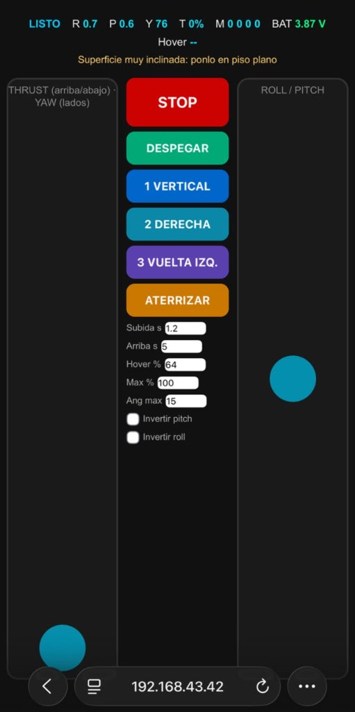

# 📘 Manual Técnico y Operativo del Minidrón ESP32-S2 UTS

**Proyecto de Grado:** Diseño e Implementación de Rutinas de Vuelo Autónomas para un Minidrón Cuadricóptero Educativo  
**Institución:** Unidades Tecnológicas de Santander (UTS)  
**Programa Académico:** Tecnología en Gestión de Sistemas de Telecomunicaciones  
**Autores:** Jhon Erick Jesús Ramírez Ortega & Ferney Jair Esparza Castro  
**Directora:** Ing. Vivian Paola Triana Galeano | **Codirector:** Ing. Johan Leandro Téllez Garzón  

---

## 📑 Tabla de Contenido
1. [Introducción y Arquitectura General](#1-introducción-y-arquitectura-general)
2. [Anatomía del Hardware: ¿Qué hace cada parte del dron?](#2-anatomía-del-hardware-qué-hace-cada-parte-del-dron)
3. [Procedimiento de Encendido y Conexión Inalámbrica](#3-procedimiento-de-encendido-y-conexión-inalámbrica)
4. [Instalación de la Aplicación Móvil (Android e iPhone)](#4-instalación-de-la-aplicación-móvil-android-e-iphone)
5. [Guía Completa de Uso de la Aplicación](#5-guía-completa-de-uso-de-la-aplicación)
6. [Manejo de Concurrencia de Comandos](#6-manejo-de-concurrencia-de-comandos)
7. [Descripción y Resultado Detallado de las Rutinas de Vuelo](#7-descripción-y-resultado-detallado-de-las-rutinas-de-vuelo)
8. [Consola Serie y Comandos de Depuración](#8-consola-serie-y-comandos-de-depuración)
9. [Protocolo de Seguridad y Solución de Problemas (Troubleshooting)](#9-protocolo-de-seguridad-y-solución-de-problemas-troubleshooting)

---

## 1. Introducción y Arquitectura General

El presente manual describe las especificaciones técnicas, el funcionamiento de cada componente, las pautas de conexión inalámbrica y los procedimientos de operación en vuelo del prototipo **ESP32-S2 Drone V1.2**. 

El sistema está concebido como una plataforma educativa de monocontrol y bajo costo, integrando procesamiento embebido en tiempo real mediante **FreeRTOS**, adquisición inercial a alta frecuencia (1 kHz), filtrado sensorial digital con el algoritmo de **Mahony** a 250 Hz y lazos cerrados de control **PID en cascada** (ángulo y velocidad angular) a 500 Hz.

* **Peso total en orden de vuelo:** ~52 gramos (incluyendo batería y protectores).
* **Dimensiones (motor a motor):** ~95 mm (diagonal).
* **Alimentación:** Batería LiPo 1S 3.7 V (800 mAh, descarga 25C).
* **Control:** WiFi 802.11 b/g/n en modo Punto de Acceso (AP) nativo.

---

## 2. Anatomía del Hardware: ¿Qué hace cada parte del dron?

Cada elemento físico del minidrón cumple una función crítica dentro del equilibrio aerodinámico y de control:

```
                  [M4: CW]    ▲ Frente    [M1: CCW]
                      \       │       /
                       \   ┌──┴──┐   /
                        ───┤ ESP ├───
                           │ 32  │
                       /   └──┬──┘   \
                      /       │       \
                  [M3: CCW]   ▼ Atrás     [M2: CW]
```

### 1. Unidad Microcontroladora: ESP32-S2 WROVER
* **Función:** Es el "cerebro" central del dron. Integra un núcleo Xtensa® LX7 a 240 MHz con conectividad WiFi 2.4 GHz.
* **Operación:** Ejecuta las tareas concurrentes de FreeRTOS:
  1. Lectura de sensores I2C y ejecución de los lazos PID de vuelo a 500 Hz (prioridad crítica).
  2. Gestión del servidor Web HTTP y recepción de paquetes de red UDP (puerto 2390).
  3. Secuenciador de rutinas autónomas y monitoreo de seguridad.

### 2. Sensor Inercial (IMU): MPU-6050
* **Función:** Es el "sistema vestibular" del dron. Integra un acelerómetro triaxial (±16 g) y un giroscopio triaxial (±2000 °/s).
* **Operación:** Se comunica por bus I2C (SDA: GPIO 11, SCL: GPIO 10) a 400 kHz. Proporciona la orientación tridimensional del dron en el espacio. El algoritmo de Mahony fusiona las lecturas de aceleración y velocidad angular para estimar con precisión los ángulos de alabeo (*Roll*), cabeceo (*Pitch*) y velocidad de guiñada (*Yaw*).

### 3. Motores DC Coreless 720 (7x20 mm)
* **Función:** Generar la sustentación y el empuje aerodinámico.
* **Operación:** Son motores de corriente continua sin núcleo de hierro, caracterizados por su bajo peso (3.5 g c/u), mínima inercia de rotor y capacidad de alcanzar más de 45.000 RPM. Operan con una modulación de ancho de pulso (**PWM**) a 15 kHz, evitando frecuencias audibles molestas y garantizando una respuesta inmediata.

### 4. Transistores MOSFET N-Channel
* **Función:** Etapa de potencia de conmutación.
* **Operación:** Los pines del ESP32 entregan señales lógicas de 3.3 V a baja corriente (~20 mA). Los transistores MOSFET actúan como interruptores electrónicos de alta velocidad que modulan la corriente de la batería (hasta 2 A por motor) entregada a los motores según la señal PWM recibida.

### 5. Hélices Tipo A y Tipo B (55 mm)
* **Función:** Transformar la rotación del motor en fuerza de empuje ascendente.
* **Operación:** 
  * Las **Hélices A** giran en sentido horario (**CW** - *Clockwise*) en los motores M2 y M4.
  * Las **Hélices B** giran en sentido antihorario (**CCW** - *Counter-Clockwise*) en los motores M1 y M3.
  * *¿Por qué giran en sentidos opuestos?* Por la Tercera Ley de Newton, cada hélice ejerce un torque reactivo sobre el chasis. Al tener dos motores girando en CW y dos en CCW, los torques se anulan en vuelo estacionario. Modulando la diferencia de velocidad entre pares diagonales, el dron gira suavemente sobre su eje vertical (*Yaw*) sin desestabilizarse.

### 6. Batería LiPo 1S 3.7 V (800 mAh) y Divisor Resistivo de Voltaje
* **Función:** Proporcionar la energía eléctrica al sistema y monitorear el nivel de carga.
* **Operación:** La batería entrega alta corriente de descarga instantánea. El voltaje se mide continuamente a través de un divisor resistivo conectado al pin analógico **ADC1 (GPIO 2)**. Si el voltaje desciende por debajo de 3.2 V, el firmware activa el protocolo de aterrizaje forzoso para evitar descargas profundas destructivas de la celda de litio.

### 7. Chasis (Frame) en Fibra de Vidrio / Polímero
* **Función:** Soporte estructural con geometría en "X".
* **Operación:** Absorbe vibraciones mecánicas generadas por los motores gracias a dampers de goma y mantiene la rigidez torsional necesaria para que las lecturas del MPU6050 sean fidedignas.

---

## 3. Procedimiento de Encendido y Conexión Inalámbrica

Para operar el minidrón con total seguridad, siga estrictamente el protocolo de inicio:

1. **Colocación en Superficie Plana:**
   * Sitúe el dron en un suelo completamente nivelado y despejado.
2. **Encendido:**
   * Conecte la batería LiPo al conector JST. Los LEDs de la placa comenzarán a parpadear.
3. **Calibración Automática de Reposo (MUY IMPORTANTE):**
   * **NO mueva ni toque el dron durante los primeros 5 segundos.**
   * Durante este lapso, el firmware realiza la calibración del sesgo (*bias*) del giroscopio mediante varianza estadística. Si el dron se mueve, el cero de rotación quedará desfasado y el dron tenderá a irse hacia un lado al despegar.
4. **Verificación de Red Wi-Fi:**
   * El microcontrolador levantará una red inalámbrica con los siguientes parámetros:
     * **SSID:** `ESP-DRONE_XXXX` (donde XXXX son los últimos dígitos de la MAC).
     * **Contraseña:** `12345678`
     * **Dirección IP del Dron:** `192.168.43.42`
     * **Puerto UDP de Telemetría:** `2390`
5. **Conexión del Teléfono o PC:**
   * Encienda el Wi-Fi en su dispositivo móvil y conéctese a la red del dron ingresando la clave `12345678`.
   * En caso de que el sistema operativo advierta *"Red Wi-Fi sin conexión a Internet"*, confirme la opción **"Mantener conexión"** (no permita que el celular cambie automáticamente a datos móviles).

---

## 4. Instalación de la Aplicación Móvil (Android e iPhone)

### 🤖 Para Teléfonos Android (Instalación de APK)
1. Descargue el archivo `ESP_DRONE_UTS_v1.0.apk` ubicado en la carpeta `mobile_app/` de este repositorio.
2. En su dispositivo, habilite la casilla **"Permitir la instalación de fuentes desconocidas"** en la configuración de seguridad.
3. Abra el archivo descargado y presione **Instalar**.
4. Conéctese a la red Wi-Fi del dron y ejecute la aplicación.

### 🍏 Para Teléfonos iPhone / iOS (Modo PWA - Safari)
> **Aclaración Técnica:** Los archivos `.apk` son incompatibles con iOS. Apple no permite la apertura ni instalación de paquetes Android. Sin embargo, el dron integra una **Progressive Web App (PWA)** en su servidor embebido que funciona con rendimiento idéntico al de una app nativa.

**Pasos de instalación en iPhone:**
1. Conéctese al Wi-Fi del dron (`ESP-DRONE_XXXX`, clave `12345678`).
2. Abra **Safari** e ingrese a la dirección: **`http://192.168.43.42`**.
3. Presione el botón **Compartir** de Safari (el ícono del cuadro con flecha vertical 📤 en la parte inferior).
4. Seleccione la opción **"Agregar a pantalla de inicio"** (*Add to Home Screen*).
5. Confirme el nombre (por ejemplo, *ESP-DRONE UTS*) y toque **"Agregar"**.
6. En su pantalla aparecerá el ícono de la app. Al pulsarlo, se ejecutará en **pantalla completa**, sin barra de direcciones, con controles táctiles y respuesta en tiempo real.

---

## 5. Guía Completa de Uso de la Aplicación

<p align="center">
  
</p>

La interfaz de usuario está dividida en cuatro bloques operativos:

### 🎮 A. Joysticks Virtuales Táctiles (Vuelo Manual)
* **Joystick Izquierdo (Modo 2 - Throttle / Yaw):**
  * **Eje Vertical (Thrust / Empuje):** Modula la potencia general de sustentación (0 a 100 %). Al soltarlo vuelve al punto neutro o retiene la posición programada.
  * **Eje Horizontal (Yaw / Guiñada):** Hace rotar el dron sobre su eje perpendicular (giro horario o antihorario) sin desplazarse del punto.
* **Joystick Derecho (Roll / Pitch):**
  * **Eje Vertical (Pitch / Cabeceo):** Inclina el dron hacia adelante (baja el frente) o hacia atrás (sube el frente) para traslación longitudinal.
  * **Eje Horizontal (Roll / Alabeo):** Inclina el dron hacia la izquierda o hacia la derecha para traslación lateral.

### 🔘 B. Botones de Control de Vuelo
* 🛑 **STOP (Parada de Emergencia):**
  * **Efecto:** Corta de manera instantánea el 100 % del PWM a los 4 motores (potencia 0). Se debe presionar ante cualquier colisión inminente o pérdida de orientación.
* 🛫 **DESPEGAR (Despegue Progresivo):**
  * **Efecto:** Inicia una aceleración suave mediante curva S durante 3 segundos hasta alcanzar la potencia nominal de sustentación (*Hover* = 64-70 %), manteniéndose flotando de forma asistida.
* 🛬 **ATERRIZAR:**
  * **Efecto:** Reduce el empuje gradualmente a una tasa controlada hasta que el acelerómetro detecta contacto con el piso (>20 ms), momento en el cual apaga los motores automáticamente.
* 1️⃣ **1 VERTICAL:**
  * **Efecto:** Dispara la Rutina 1 de despegue vertical autónomo, sustentación y aterrizaje suave.
* 2️⃣ **2 DERECHA:**
  * **Efecto:** Dispara la Rutina 2 de despegue, traslación lateral a la derecha/izquierda, frenado dinámico y aterrizaje.
* 3️⃣ **3 VUELTA IZQ.:**
  * **Efecto:** Dispara la Rutina 3 de despegue vertical, rotación yaw de 360° en sentido antihorario y aterrizaje en una posición diferente a la de partida.

### ⚙️ C. Parámetros de Calibración y Control en Pantalla
* **Subida s [1.2]:** Tiempo en segundos de aceleración ascendente tras despegar del suelo (por defecto: `1.2` s).
* **Arriba s [5]:** Tiempo de sustentación estacionaria (*Hover*) en el punto más alto antes de descender (por defecto: `5.0` s).
* **Hover % [64]:** Porcentaje base de aceleración PWM calibrado para vencer el peso del dron (por defecto: `64 %`).
* **Max % [100]:** Límite máximo de potencia PWM permitido a los motores coreless.
* **Ang max [15]:** Ángulo máximo de inclinación permitido por el lazo PID para prevenir sobreinclinación (tope de seguridad: `15°`).
* **Invertir pitch / Invertir roll:** Casillas de verificación para adaptar el sentido de control de los joysticks según la orientación del operador.
* **Avisos de Nivelación:** Mensajes de seguridad interactivos como *"Superficie muy inclinada: ponlo en piso plano"* si los ángulos iniciales exceden el margen admisible para calibrar.

### 📊 D. Panel de Telemetría en Tiempo Real
* **R (Roll):** Ángulo de inclinación lateral actual en grados (°).
* **P (Pitch):** Ángulo de inclinación longitudinal actual en grados (°).
* **Y (Yaw):** Orientación angular azimutal actual en grados (°).
* **T (Thrust):** Porcentaje de aceleración global aplicado (0 a 100 %).
* **M (M1, M2, M3, M4):** Potencia porcentual individual enviada a cada motor por el mezclador en X.
* **BAT:** Voltaje medido en tiempo real de la batería LiPo (ejemplo: `3.87 V`).
* **Estado:** Mensaje del secuenciador interno (`LISTO`, `CALIBRANDO`, `DESPEGANDO`, `EN EL AIRE`, `ATERRIZANDO`).

---

## 6. Manejo de Concurrencia de Comandos

### ¿Qué sucede si se presionan la Rutina 1 y la Rutina 2 al mismo tiempo?
En pruebas prácticas o en situaciones de pulsación accidental, puede surgir la duda de qué ocurre si el piloto oprime simultáneamente dos botones de rutina (o envía órdenes rápidas consecutivas).

**Comportamiento del Firmware:**
1. **No se genera conflicto ni bloqueo:** El servidor web y el secuenciador procesan las solicitudes de manera estrictamente atómica y secuencial en el bucle principal (`server.handleClient()` y `handleUdp()`).
2. **Máquina de Estados Finita (`runSeq()`):** El secuenciador de vuelo implementa una máquina de estados determinística (`SEQ_IDLE`, `SEQ_CALIB`, `SEQ_CLIMB`, `SEQ_HOVER`, `SEQ_MOVE`, `SEQ_LAND`).
3. **Descarte de órdenes concurrentes:** Para iniciar cualquier rutina, el sistema verifica que el estado actual sea estrictamente **`SEQ_IDLE`** (en reposo / suelo). Si la Rutina 1 ya inició su ejecución, la variable de estado cambia inmediatamente a `SEQ_CALIB` / `SEQ_CLIMB`. Cualquier solicitud posterior para ejecutar la Rutina 2 o Rutina 3 es **completamente descartada e ignorada** por el firmware hasta que el ciclo de vuelo concluya satisfactoriamente y los motores se apaguen.
4. **Excepción de Prioridad:** El único comando con capacidad de interrupción inmediata sobre cualquier rutina en curso es **`STOP`** (o **`ATERRIZAR`**), los cuales cortan o transicionan de inmediato al descenso de seguridad.

---

## 7. Descripción y Resultado Detallado de las Rutinas de Vuelo

Cada una de las tres rutinas programadas ejecuta una secuencia cinemática predefinida y reproducible:

```
[Inicio: Suelo] ──► [Calibración 1s] ──► [Despegue Curva S] ──► [Maniobra] ──► [Descenso Suave] ──► [Apagado: LISTO]
```

---

### 1️⃣ Rutina 1: Vuelo Vertical Asistido (Hover Estacionario)
* **Descripción Operativa:** El minidrón inicia en el suelo sobre superficie plana, se eleva de forma vertical durante un intervalo de tiempo programado (1.2 s de ascenso + 5.0 s de hover estacionario), desciende progresivamente hasta posarse suavemente en el suelo, apaga los motores y queda en reposo a la espera de su siguiente orden.
* **Objetivo:** Demostrar despegue autónomo, sustentación estable en punto fijo y aterrizaje sin volcaduras.
* **Secuencia de Fases:**
  1. **Fase 0 (Inicio):** Dron posado en el suelo en estado `LISTO`. Batería mayor a 3.8 V.
  2. **Fase 1 (Recalibración Inercial - 1.0 s):** Los motores permanecen apagados mientras el MPU6050 recalibra el sesgo del giroscopio (esencial si el sensor está caliente tras un vuelo previo).
  3. **Fase 2 (Rampa de Despegue Progresiva):** Se eleva el empuje suavemente siguiendo una rampa matemática hasta que el acelerómetro vertical ($a_z$) detecta la pérdida de contacto con el suelo.
  4. **Fase 3 (Ascenso Controlado - 1.2 s):** El empuje se fija en el valor de *Hover* con rampa positiva, alcanzando una cota de altura de **~35 a 40 cm**.
  5. **Fase 4 (Sustentación Estacionaria / Hover - 5.0 s):** El dron permanece flotando en el aire. El lazo PID en cascada corrige activamente cualquier desbalance de peso o corrientes de aire manteniendo los ángulos en $0^\circ \pm 1.5^\circ$.
  6. **Fase 5 (Descenso Progresivo):** El empuje decrece paulatinamente a razón de 0.5 %/s para mitigar el efecto de vórtice de anillo (*vortex ring state*).
  7. **Fase 6 (Contacto y Apagado):** Al tocar tierra, la desaceleración sostenida (>20 ms) confirma el aterrizaje; los motores se apagan de inmediato ($0\%$). El dron vuelve al estado `LISTO` a la espera de su siguiente orden.
* **Tiempo Total Estimado:** ~10 a 11 segundos.

---

### 2️⃣ Rutina 2: Traslación Lateral Derecha Coordinada
* **Descripción Operativa:** El minidrón inicia en el suelo, se eleva verticalmente y realiza una inclinación lateral controlada hacia un costado (desplazamiento hacia la derecha o izquierda según su orientación inicial), frena dinámicamente su inercia, desciende suavemente hasta aterrizar, apaga motores y queda a la espera de su siguiente orden.
* **Objetivo:** Demostrar control de actitud direccional en el eje de alabeo (*Roll*), desplazamiento horizontal y frenado inercial activo.
* **Secuencia de Fases:**
  1. **Fase 0 y 1 (Calibración y Despegue):** Recalibración del giroscopio (1.0 s) y ascenso vertical durante 1.2 s hasta alcanzar la cota de crucero (~35 a 40 cm).
  2. **Fase 2 (Estabilización Previa - 0.3 s):** Nivela las velocidades angulares antes de iniciar el movimiento.
  3. **Fase 3 (Inclinación y Desplazamiento - 1.2 s):** El controlador inyecta una consigna de inclinación de **Roll = +8.0° hacia la derecha**. El dron se desplaza lateralmente recorriendo una distancia de aproximadamente **50 a 60 cm**.
  4. **Fase 4 (Frenado Activo y Contrarresto - 1.2 s):** Para anular la inercia acumulada, el lazo aplica una consigna de contrarresto de alabeo hacia la izquierda (Roll negativo) hasta detener el avance lateral.
  5. **Fase 5 (Estabilización en Punto Fijo - 1.5 s):** El dron retoma el ángulo horizontal plano ($0^\circ$).
  6. **Fase 6 (Aterrizaje y Apagado):** Rampa suave de descenso, contacto con el suelo, corte de PWM a 0 % y transición al estado `LISTO` a la espera de su siguiente orden.
* **Tiempo Total Estimado:** ~12 a 13 segundos.

---

### 3️⃣ Rutina 3: Giro de Guiñada (Yaw) 360° en Sentido Antihorario
* **Descripción Operativa:** El minidrón se eleva desde el suelo, realiza una traslación hacia su izquierda ejecutando un giro coordinado sobre su eje de guiñada (Yaw) y aterriza en un punto distante de su posición de partida, apagando motores y quedando a la espera de su siguiente orden.
* **Objetivo:** Demostrar desacoplo aerodinámico y control independiente sobre el eje Z (*Yaw*) mediante diferencial de torque reactivo de los motores.
* **Secuencia de Fases:**
  1. **Fase 0 y 1 (Calibración y Despegue):** Calibración de referencia inercial y elevación suave hasta ~35 a 40 cm de altura.
  2. **Fase 2 (Estabilización de Actitud - 0.3 s):** Nivela el dron en posición horizontal.
  3. **Fase 3 (Rotación Controlada de 360° - ~4.0 s):** El controlador de velocidad angular comanda una velocidad de giro sostenida de **$\dot{\psi} = 90^\circ/\text{s}$ en sentido antihorario** (hacia la izquierda visto desde arriba). Los motores CCW (M1 y M3) aceleran ligeramente mientras los CW (M2 y M4) deceleran, generando el torque puro sin alterar la sustentación global. El dron completa una circunferencia de 360°.
  4. **Fase 4 (Frenado de Rotación y Amortiguamiento - 1.5 s):** El PID de yaw aplica torque inverso para frenar la rotación exactamente al completar el giro, estabilizando la orientación.
  5. **Fase 5 (Descenso y Apagado):** Reducción de potencia, detección de superficie de aterrizaje en un punto distante al inicial, corte de motores y retorno al estado `LISTO` a la espera de su siguiente orden.
* **Tiempo Total Estimado:** ~14 segundos.

---

## 8. Consola Serie y Comandos de Depuración

Al conectar la tarjeta ESP32-S2 a una computadora mediante cable USB, abra el Monitor Serie del Arduino IDE (o terminal como PuTTY) a una velocidad de **115200 baudios** con terminación de línea `"Nueva línea"` (*Newline*).

Escriba los siguientes comandos interactivos para depuración avanzada:

| Comando | Descripción |
| :--- | :--- |
| `help` | Imprime la lista completa de comandos disponibles en pantalla. |
| `s` | Parada de emergencia inmediata (corta todos los motores a 0 %). |
| `auto` | Dispara el despegue progresivo automático (hover mantenido). |
| `land` | Inicia la secuencia de aterrizaje suave controlado. |
| `seq 1` | Ejecuta la **Rutina 1** (Vertical / Hover). |
| `seq 2` | Ejecuta la **Rutina 2** (Desplazamiento a la Derecha). |
| `seq 3` | Ejecuta la **Rutina 3** (Vuelta Izquierda 360°). |
| `m <M1> <M2> <M3> <M4>` | Prueba individual de motores con porcentaje directo (ejemplo: `m 15 15 15 15` sin hélices). |
| `bat` | Consulta el voltaje actual de la batería LiPo en voltios (V). |
| `pid` | Muestra en pantalla las ganancias PID actuales ($K_p$, $K_i$, $K_d$) de ángulo y tasa. |
| `set <param> <val>` | Modifica parámetros al vuelo (`set hover 72`, `set subida 1.5`, `set arriba 6`). |
| `log` | Activa o desactiva la impresión en vivo de la telemetría (ángulos y motores). |
| `batcomp <0|1>` | Habilita o deshabilita la compensación dinámica por caída de voltaje de batería. |

---

## 9. Protocolo de Seguridad y Solución de Problemas (Troubleshooting)

### Reglas Básicas de Seguridad en Pruebas
1. **Espacio de Vuelo Delimitado:** Realice siempre las pruebas en interiores, en una zona cerrada de al menos 2 x 2 metros, libre de obstáculos, personas o corrientes de aire acondicionado directas.
2. **Primera Prueba Sin Hélices:** Tras compilar o cargar un nuevo firmware, realice siempre una prueba de encendido y aceleración sin las hélices instaladas para verificar que los motores giran en los sentidos correctos:
   * **M1 (Frontal Derecho):** Giro CCW (antihorario).
   * **M2 (Trasero Derecho):** Giro CW (horario).
   * **M3 (Trasero Izquierdo):** Giro CCW (antihorario).
   * **M4 (Frontal Izquierdo):** Giro CW (horario).
3. **Mínimo de Batería:** No inicie rutinas con voltaje inferior a **3.80 V** en reposo. Las baterías LiPo sufren caída de tensión bajo carga (*voltage sag*), y una batería gastada no podrá generar el empuje de sustentación requerido.

### Solución de Problemas Comunes

| Síntoma | Causa Probable | Solución |
| :--- | :--- | :--- |
| El dron se voltea de inmediato al intentar despegar. | Hélices invertidas o motores cruzados. | Verifique que las hélices A estén en M2/M4 y las hélices B en M1/M3. Asegúrese de que no estén colocadas al revés (la cara convexa debe mirar hacia arriba). |
| El dron se desplaza fuertemente hacia un lado al despegar. | Giroscopio mal calibrado al encender. | Apague el dron, apóyelo sobre una superficie completamente plana y enciéndalo de nuevo sin tocarlo ni vibrarlo durante 5 segundos. |
| Los motores giran pero el dron no despega del suelo. | Batería descargada o hélices al revés empujando hacia abajo. | Mida la batería con el comando `bat` (debe ser $\ge 3.8\text{ V}$). Compruebe que el flujo de aire sople hacia abajo y no hacia arriba. |
| La app o navegador no se conecta a `192.168.43.42`. | Celular cambió a datos móviles o Wi-Fi desconectado. | Desactive los datos móviles en su celular para obligar a que todo el tráfico local vaya por la red Wi-Fi del dron. Verifique el SSID. |
| La rutina aborta antes de subir. | Voltaje cae por debajo de 3.2 V bajo carga o acelerómetro detectó inclinación > 60°. | Recargue la batería LiPo a 4.20 V con el cargador TP4056. Revise que la superficie de despegue esté nivelada. |

