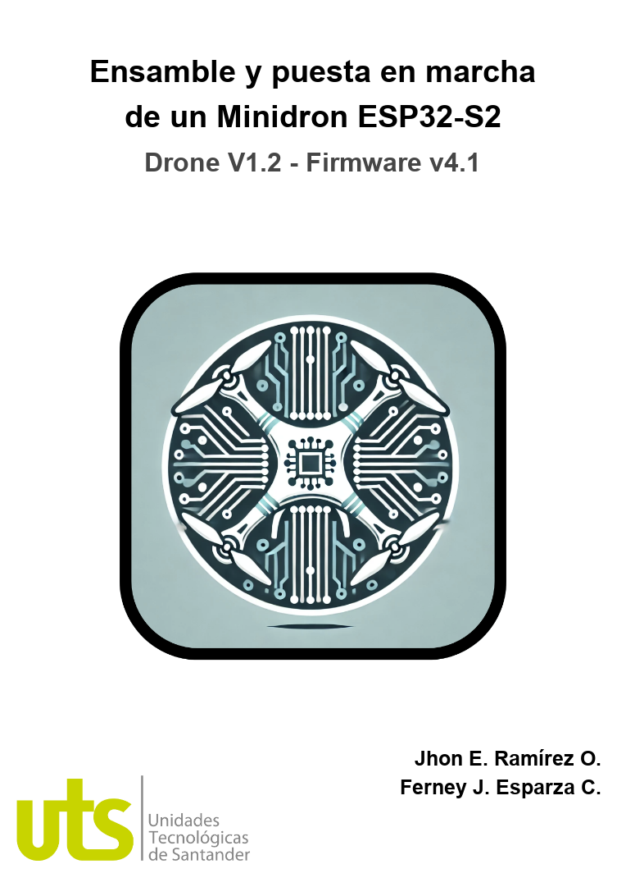

# Manual Técnico-Operativo: Ensamble, Configuración y Operación del Minidrón Educativo ESP32-S2

  

Este manual técnico ha sido consolidado como el **Anexo B** del trabajo de grado titulado:
> **"Desarrollo de rutinas de vuelo automatizadas básicas en un minidrón ESP-Drone basado en ESP32-S2 WROVER y MPU6050 mediante aplicación móvil"**  
> *Tecnología en Gestión de Sistemas de Telecomunicaciones — Unidades Tecnológicas de Santander (UTS)*  
> **Autores:** Jhon Erick Jesús Ramírez Ortega y Ferney Jair Esparza Castro  
> **Directora:** Ing. Vivian Paola Triana Galeano | **Codirector:** Ing. Johan Leandro Téllez Garzón

---

## 📑 Contenido del Manual

1. **Introducción y Público Objetivo**
   * Plataforma educativa de robótica aérea de bajo costo orientada a semilleros y estudiantes de telecomunicaciones/electrónica.
2. **Componentes del Sistema**
   * Placa principal ESP32-S2 Drone V1.2 (SoC Xtensa LX7 a 240 MHz, 320 KB SRAM, 4 MB Flash).
   * Unidad de Medición Inercial (IMU) MPU6050 (giroscopio y acelerómetro triaxial por bus I²C).
   * Motores coreless de alta velocidad (brushed 7x16 mm / 8520).
   * Hélices contrarrotatorias (2 CW y 2 CCW de 45-55 mm).
   * Batería LiPo 1S 3.7 V (300 a 500 mAh, tasa mínima 25C) y módulo cargador TP4056 con protección.
3. **Herramientas Necesarias**
   * Cautín con punta fina (30W-60W), soldadura de estaño 60/40 de 0.5-0.8 mm, pasta de soldar.
   * Pinzas antiestáticas, multímetro digital, cable micro USB de datos (24-28 AWG).
4. **Ensamblaje del Hardware**
   * **Soldadura de Motores:** Conexión estricta respetando polaridades y diagrama en "X" (M1 Delantero Derecho CCW, M2 Trasero Derecho CW, M3 Trasero Izquierdo CCW, M4 Delantero Izquierdo CW).
   * **Colocación de Hélices:** Distribución horaria y antihoraria para equilibrio del torque aerodinámico ($Drag\ Torque$).
   * **Fijación de Batería:** Centro de gravedad balanceado sobre el eje geométrico del PCB.
5. **Configuración del Entorno de Desarrollo**
   * Instalación de Arduino IDE (v2.x) y adición del paquete de placas ESP32 de Espressif (`https://raw.githubusercontent.com/espressif/arduino-esp32/gh-pages/package_esp32_index.json`).
   * Selección de placa: *ESP32-S2 Dev Module*, habilitando soporte de USB nativo CDC y modo de subida en bootloader.
   * Instalación de librerías: `MPU6050` (Electronic Cats / Jeff Rowberg), `Wire`, `WiFi`, `WebServer`.
6. **Compilación y Carga del Firmware (`esp_drone_firmware.ino`)**
   * Procedimiento de puesta en modo *Download*: mantener presionado botón BOOT, presionar y soltar RST, y soltar BOOT.
   * Verificación a través del monitor serie a 115200 baudios (lectura de calibración inercial y mensaje de red activa).
7. **Conexión, Control Web y Aplicación Móvil**
   * Red WiFi SoftAP: SSID `ESP-DRONE-UTS` | Contraseña: `12345678`.
   * Acceso por navegador web a la IP fija: `http://192.168.43.42` (Panel de control embebido en HTML5).
   * Enlace a través de la aplicación móvil nativa (`ESP DRONE UTS`).
8. **Procedimiento de Calibración**
   * Calibración de superficie plana (*Gyro Bias Offsets*).
   * Ajuste fino digital de Trims motrices (±50 unidades de microsegundos de empuje).
9. **Operación y Secuencias de Vuelo**
   * Secuencia de Rutina 1: Despegue gradual, hover estacionario y descenso suave.
   * Protocolo de Parada de Emergencia Inmediata ante contingencias.

---

## 📥 Descargas Oficiales
* [Descargar Manual en formato PDF](Manual_Tecnico_MiniDron_ESP32.pdf)
* [Descargar Manual en formato Word DOCX](Manual_Tecnico_MiniDron_ESP32.docx)
